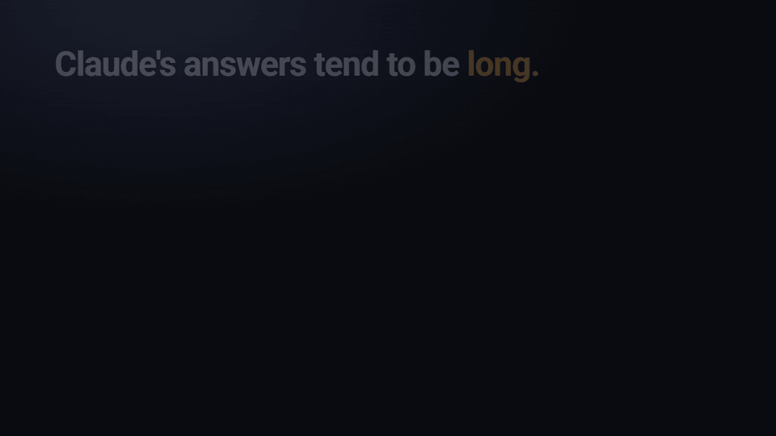

# claude-cli-browser-terminal (ccw)

Claude CLI finally has a reply button.

Read replies like a book, with your terminal beside them in one browser page. Click any sentence to reply, then send everything with one shortcut.




## Why

Claude's answers tend to be long. In a terminal you scroll up to find where a reply starts, and decide where to stop. The bigger friction is replying: to show which part you mean, you copy it, paste it into your message, and repeat. VS Code is no better. Reading the full transcript is worse: Claude CLI's Ctrl+O mode means more scrolling, and on Windows Terminal with PowerShell the scrolling is intolerable.

Making Claude answer shorter didn't work, so ccw makes long answers easy to read and reply to.

## Features

1. **Side by side.** Your Claude terminal on the left, the reply on the right, rendered as markdown and read like an ebook. No terminal scrolling.
2. **Click to reply.** Click any sentence; no need to select text first.
3. **One-key replies.** Picking a sentence opens 11 reply icons, one key each: F fix it, E explain, C double check, T too noisy, X remove, S research, R reply, Y yes/ok, N no/wrong, G go ahead, D done. Hover an icon to see the text it sends.
4. **Keyboard only.** Press F in the reply: every sentence in view gets a short label. Type a label to pick that sentence. F or Esc ends it.
5. **Several threads in one message.** Comment on as many sentences as you like, then send them all with Ctrl+Enter or Alt+Enter.
6. **Previous replies at a key.** ← → steps through turns (or ‹ › beside the gear). Older pages are read-only, "new" marks newer output, and the latest page keeps its comments.
7. **Live turn view.** See what Claude does during a turn: a status bar with running or done, time, tool calls, tokens, model and mode. Thinking, tool calls and housekeeping fold into one line per group; open a group for each tool's request, response and why it was allowed.
8. **Follows the session.** The reply pane keeps up across `/cd`, `/clear`, `/resume` and worktrees.
9. **Comments are safe.** Reloading or closing the tab asks first, links show as plain text so a click can't leave the page, and Esc in the comment box asks before discarding changes.
10. **File references open in place.** A reference such as `web/main.js:83` is a link. A click shows the file over the terminal with the lines marked, and a double click opens it in your editor at that line. A file outside the project shows in red. ccw asks Claude to give every reference a line number.

## Install

<!-- install-ccw, a pwsh function in the user's $PROFILE, fetches this README and runs the first line that starts with `pnpm add -D ` or `npm install -D `. Keep those lines exact. It serves only the user: other users copy the command, which is the same effort. -->

pnpm:

```
pnpm add -D https://github.com/jigargosar/claude-cli-browser-terminal/raw/main/published-versions/claude-cli-browser-terminal-0.1.18.tgz
```

<!-- npm 12 needs --allow-remote=all to install a tarball URL. -->
npm:

```
npm install -D --allow-remote=all https://github.com/jigargosar/claude-cli-browser-terminal/raw/main/published-versions/claude-cli-browser-terminal-0.1.18.tgz
```

## Use

pnpm:

```
pnpm exec ccw
```

<!-- --no: npx never downloads a registry package named ccw; it runs only the installed one. -->
npm:

```
npx --no ccw
```

A browser tab opens with the session. Flags pass through to `claude`, for example `pnpm exec ccw --model sonnet`.

## Keys

<!-- Source: CHANGELOG.md. Update this table in the same commit as a key change. -->

| Key | Where | Does |
|---|---|---|
| Click | Reply | Pick a sentence and open the reply icons |
| F | Reply | Label every sentence in view; type a label to pick it |
| F, E, C, T, X, S, R, Y, N, G, D | Reply icons | Send that reply |
| ← → | Reply | Previous / next turn |
| Ctrl+Enter, Alt+Enter | Anywhere | Send all comments |
| Click | File reference | Show the file over the terminal, lines marked |
| Double click | File reference | Open the file in your editor at that line |
| Esc | Popup / comment box / file view | Close / ask before discarding / close |

## How it's built

Claude writes almost all the code, but I set the agenda. I write the tasks and the rules in [`docs/fvp-list.md`](docs/fvp-list.md), and only I change them. Before any work, Claude works with me to gain clarity and my approval, in ccw itself and in that list. Every task starts with the pain, not the feature. One task at a time. A task is done when I've tested it and Claude has committed it. Claude asks before every release.

Design choices: carry over only the essential Claude features, and use framework-free JavaScript with direct DOM manipulation, for full control and easy unit testing.

## Status

Early and moving fast: 17 releases since 13 Oct 2026. See [`CHANGELOG.md`](CHANGELOG.md).

Open tasks and decisions: [`docs/fvp-list.md`](docs/fvp-list.md).

## License

ISC
